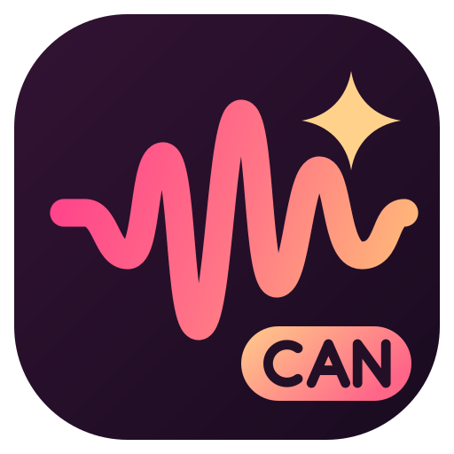
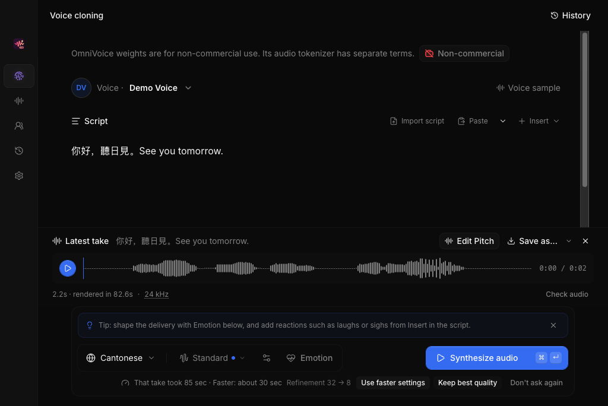
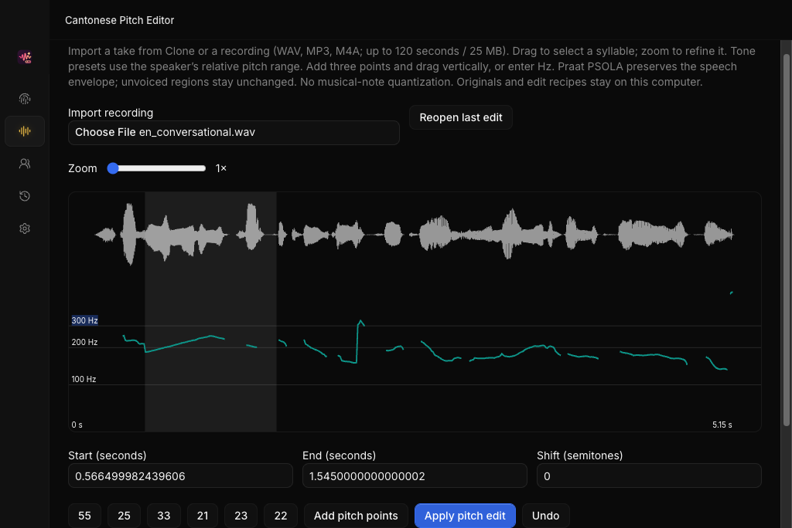
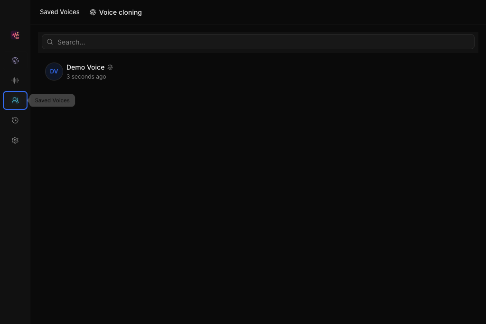
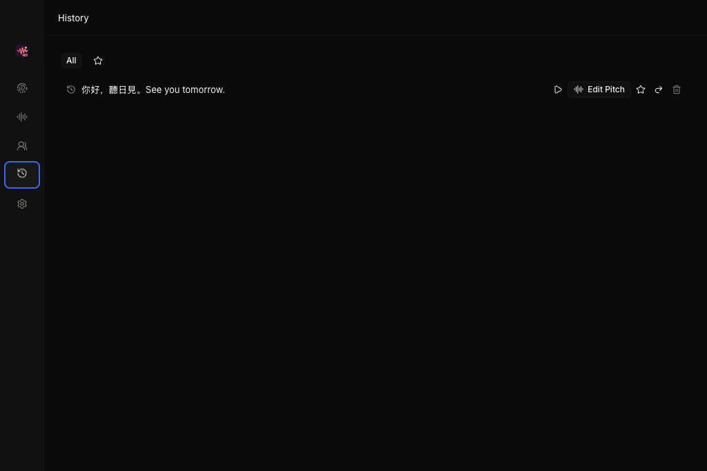
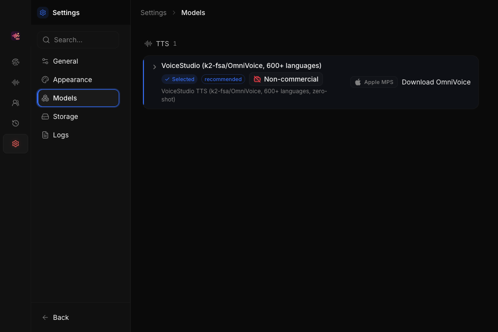

  
  <h1>Cantonese Voice Studio</h1>
  
<strong>Privacy-first Cantonese voice cloning and tone correction for Apple Silicon Macs</strong>

  
<strong>English</strong> · <a href="README.zh-HK.md">繁體中文（香港）</a>

  
<a href="https://github.com/blackjack2806969/Cantonese-Voice-Studio/releases/download/cantonese-macos-0.3.1/Cantonese-Voice-Studio-0.3.1-mac-arm64.dmg"><strong>Download v0.3.1 DMG</strong></a> · <a href="https://github.com/blackjack2806969/Cantonese-Voice-Studio/releases/download/cantonese-macos-0.3.1/Cantonese-Voice-Studio-0.3.1-mac-arm64.zip">ZIP</a> · <a href="https://github.com/blackjack2806969/Cantonese-Voice-Studio/releases/tag/cantonese-macos-0.3.1">Pre-release notes</a> · <a href="https://github.com/blackjack2806969/Cantonese-Voice-Studio/tree/cantonese-macos-0.3.1">Corresponding v0.3.1 source code</a>

## Privacy and security

Scripts, reference recordings, saved voices and generated audio are processed on your Mac without uploading them to cloud AI services. Voice cloning, speech generation, pitch editing and export all run locally. The macOS sandbox restricts the backend and audio helpers to local connections. The app blocks external requests from the renderer and disables analytics and cloud accounts. The separate OmniVoice downloader connects to the internet with your confirmation. Once the weights are installed, you can work entirely offline. [Offline enforcement](https://github.com/blackjack2806969/Cantonese-Voice-Studio/blob/cantonese-macos-0.3.1/docs/cantonese-offline.md#offline-enforcement)

## Make and edit a take

1. Install the app from the DMG on an Apple Silicon Mac. The installer is ad-hoc signed and Apple notarization is pending.
2. Open **Clone** and review the OmniVoice model terms. Reuse a complete existing model cache or choose **Download OmniVoice** (about 2.4 GiB). The Pitch Editor works without model weights. [Installation and offline model setup](https://github.com/blackjack2806969/Cantonese-Voice-Studio/blob/cantonese-macos-0.3.1/docs/cantonese-offline.md)
3. Import a clean 5–15 second reference recording with the speaker’s permission and enter its transcript. Choose Cantonese, enter your script (including English words where needed), set the speech speed and preview the take. You can save the voice for reuse.
4. From **Clone** or **History**, choose **Edit Pitch**. Select a syllable on the waveform and use a speaker-relative Cantonese tone preset (55, 25, 33, 21, 23 or 22), drag F0 points or shift by semitones. Compare before and after, undo as needed and export WAV. Edits preserve the original take.

> [!TIP]
> Generate one complete Cantonese sentence or natural phrase at a time. Context helps OmniVoice produce natural pronunciation, rhythm and intonation. Try `聽日朝早九點要開會，記得準時返嚟。` as one take. If a syllable needs a tone correction, use the Pitch Editor. If you regenerate, use the full sentence again.

## Screenshots

Five screens captured during v0.3.1 macOS ARM64 packaged-app testing. [CI run](https://github.com/blackjack2806969/Cantonese-Voice-Studio/actions/runs/46128615288)

### Clone

### Cantonese Pitch Editor

Saved Voices, History and Settings

## Source, licence and credits

The complete application and build files live on [`cantonese-offline`](https://github.com/blackjack2806969/Cantonese-Voice-Studio/tree/cantonese-offline). Use the [release source index](docs/release-source.md) to find the exact source for each distributed build. [Upstream feature catalog](docs/feature-catalog.md) · [Contributor guide](.github/CONTRIBUTING.md#contribution-licensing)

- Cantonese Voice Studio is an independent fork of VoiceStudio, originally developed by Palash Debnath, Shimul Debnath and the VoiceStudio contributors. The application is licensed under AGPL-3.0-only. [Upstream VoiceStudio](https://github.com/debpalash/VoiceStudio) · [Licence](LICENSE) · [Copyright and notices](LICENSE-NOTICE.md)
- OmniVoice code is Apache-2.0. The pretrained weights are CC BY-NC and the audio tokenizer is subject to separate Higgs Audio 2 and Meta Llama 3 terms. [Model card](https://huggingface.co/k2-fsa/OmniVoice/blob/c5fdb5ccb189668d56333f77ba2629f4cd7535f4/README.md) · [Tokenizer terms](https://huggingface.co/k2-fsa/OmniVoice/blob/c5fdb5ccb189668d56333f77ba2629f4cd7535f4/audio_tokenizer/LICENSE)
- Pitch processing uses Praat through Parselmouth (GPL-3.0-or-later). [Parselmouth](https://github.com/YannickJadoul/Parselmouth) · [Third-party model credits](https://github.com/blackjack2806969/Cantonese-Voice-Studio/blob/cantonese-macos-0.3.1/docs/model-credits.md)
