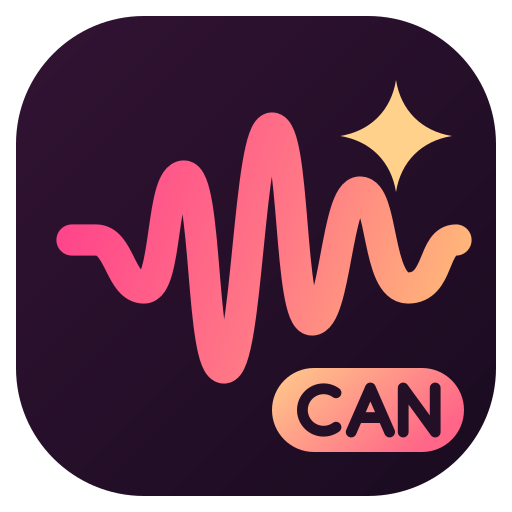
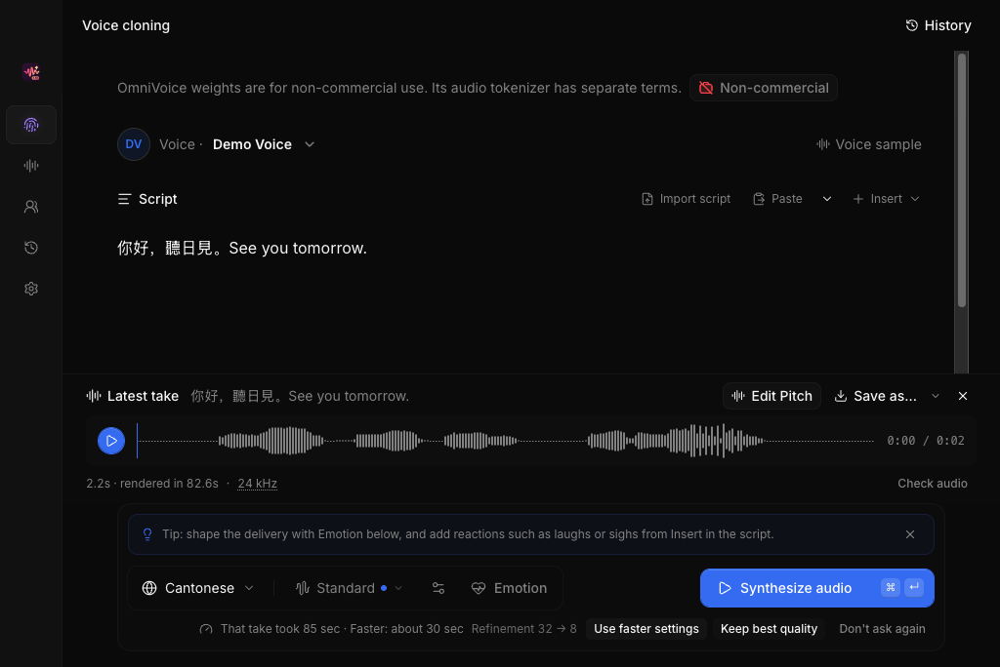
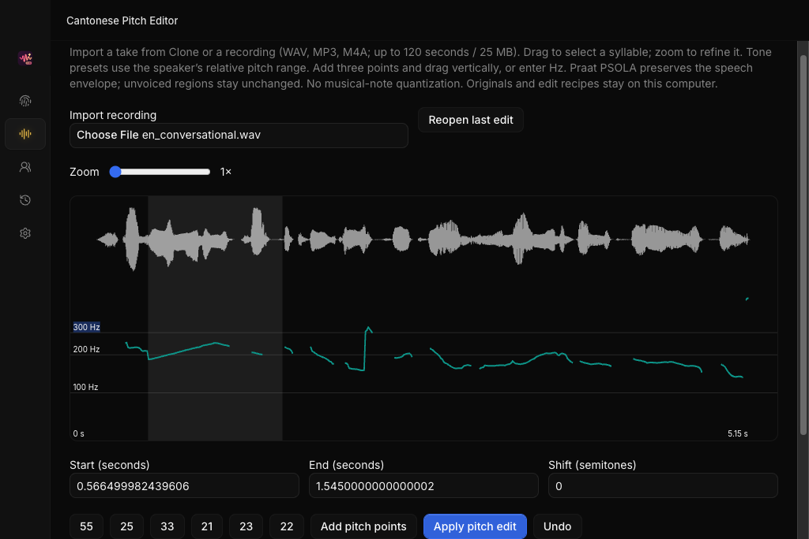
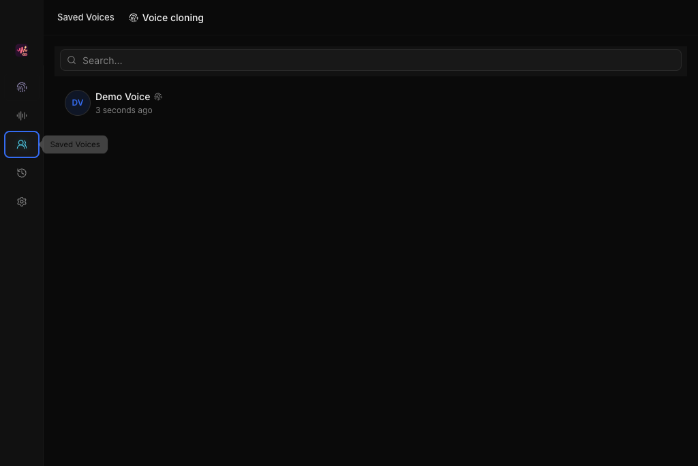
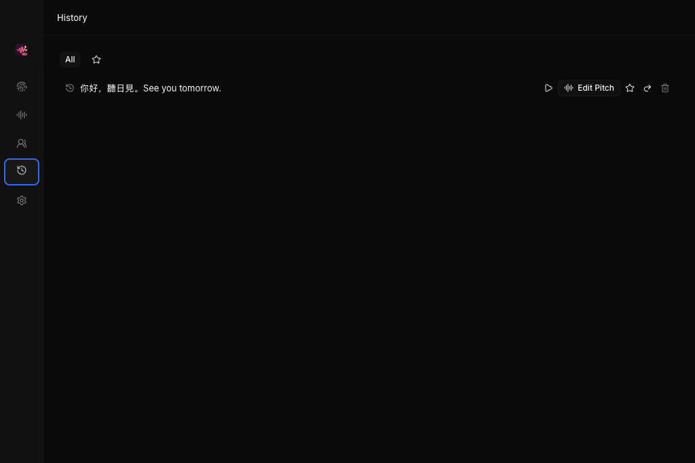
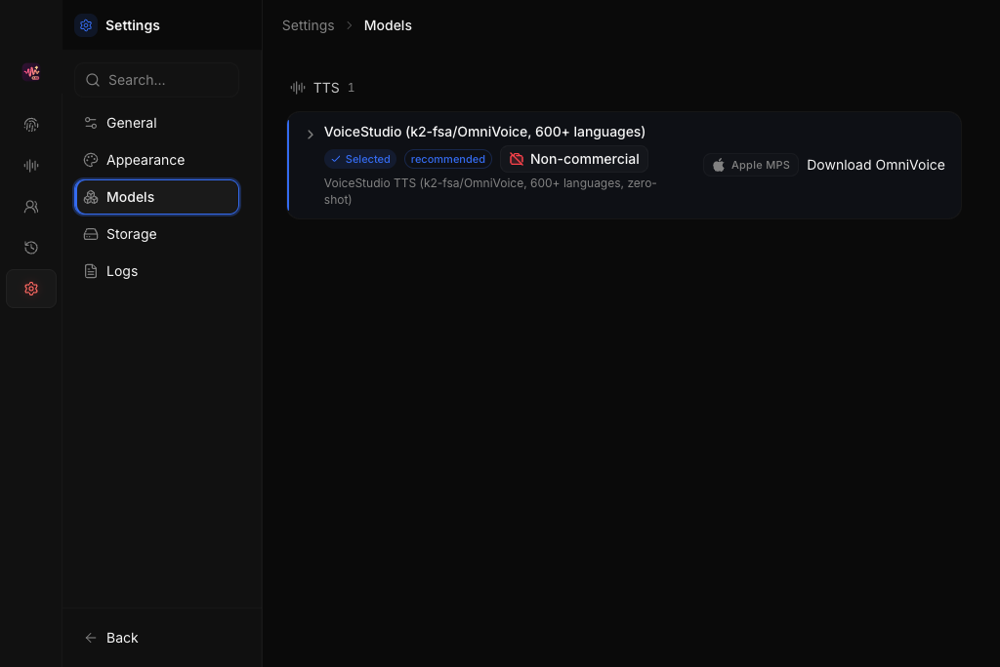

  
  <h1>Cantonese Voice Studio</h1>
  
<strong>為 Apple Silicon Mac 而設、以私隱為先嘅廣東話語音複製及聲調修正工具</strong>

  
<a href="README.md">English</a> · <strong>繁體中文（香港）</strong>

  
<a href="https://github.com/blackjack2806969/Cantonese-Voice-Studio/releases/download/cantonese-macos-0.3.1/Cantonese-Voice-Studio-0.3.1-mac-arm64.dmg"><strong>下載 v0.3.1 DMG</strong></a> · <a href="https://github.com/blackjack2806969/Cantonese-Voice-Studio/releases/download/cantonese-macos-0.3.1/Cantonese-Voice-Studio-0.3.1-mac-arm64.zip">ZIP</a> · <a href="https://github.com/blackjack2806969/Cantonese-Voice-Studio/releases/tag/cantonese-macos-0.3.1">預發佈版本說明</a> · <a href="https://github.com/blackjack2806969/Cantonese-Voice-Studio/tree/cantonese-macos-0.3.1">v0.3.1 對應原始碼</a>

## 私隱同資訊保安

配音稿、參考錄音、已儲存聲線同生成音訊都喺 Mac 本機處理，唔會上載至雲端 AI 服務。語音複製、文字轉語音、聲調修正同輸出全部喺本機完成。macOS 沙盒限制後端同音訊處理程序只用本地連線。App 亦會封鎖介面程序嘅外部網絡請求，並停用分析追蹤同雲端帳戶。獨立嘅 OmniVoice 下載程序會喺你確認後先連接網絡。安裝模型權重之後，就可以完全離線工作。[離線網絡限制（英文）](https://github.com/blackjack2806969/Cantonese-Voice-Studio/blob/cantonese-macos-0.3.1/docs/cantonese-offline.md#offline-enforcement)

## 生成同修正語音

1. 喺 Apple Silicon Mac 開啟 DMG 安裝。安裝包採用 ad-hoc 簽署，尚未經 Apple 公證。
2. 開啟 **Clone**，閱讀 OmniVoice 模型條款。可以重用完整嘅模型快取，或者選擇 **Download OmniVoice**（約 2.4 GiB）。修音工具毋須安裝模型權重。[安裝及離線模型設定（英文）](https://github.com/blackjack2806969/Cantonese-Voice-Studio/blob/cantonese-macos-0.3.1/docs/cantonese-offline.md)
3. 匯入一段約 5–15 秒、清晰而且已獲講者同意嘅參考錄音，再輸入逐字稿。選擇廣東話，輸入配音稿（可以夾雜英文），設定語速同試聽。你可以儲存聲線下次再用。
4. 喺 **Clone** 或 **History** 選擇 **Edit Pitch**。喺波形選取音節，套用按講者音域調整嘅廣東話六聲預設（55、25、33、21、23、22），拖動 F0 音高點，或者按半音調整。可以比較修正前後、復原同輸出 WAV，原始音訊會保留。

> [!TIP]
> 每次生成一句完整嘅廣東話句子或者一個自然短語。完整語境有助 OmniVoice 讀出自然嘅發音、節奏同語調。可以試下一次過生成「聽日朝早九點要開會，記得準時返嚟。」個別音節需要修正聲調，就用修音工具。如果要重新生成，建議再生成成句。

## 實際介面

五張截圖擷取自 v0.3.1 macOS ARM64 打包應用程式測試。[CI 紀錄](https://github.com/blackjack2806969/Cantonese-Voice-Studio/actions/runs/46128615288)

### 語音複製

### 廣東話修音

已儲存聲線、歷史紀錄同設定

## 原始碼、授權同鳴謝

完整應用程式原始碼同建置檔案存放喺 [`cantonese-offline`](https://github.com/blackjack2806969/Cantonese-Voice-Studio/tree/cantonese-offline)。每個已發佈版本嘅對應原始碼可喺[版本原始碼索引（英文）](docs/release-source.md)查閱。 [上游功能目錄（英文）](docs/feature-catalog.md)

- Cantonese Voice Studio 係 VoiceStudio 嘅獨立衍生版本。VoiceStudio 原由 Palash Debnath、Shimul Debnath 同其他貢獻者開發。應用程式採用 AGPL-3.0-only 授權。[上游 VoiceStudio](https://github.com/debpalash/VoiceStudio) · [授權全文](LICENSE) · [版權及授權聲明](LICENSE-NOTICE.md)
- OmniVoice 程式碼採用 Apache-2.0。預訓練模型權重採用 CC BY-NC，音訊 tokenizer 另受 Higgs Audio 2 同 Meta Llama 3 條款約束。[模型卡](https://huggingface.co/k2-fsa/OmniVoice/blob/c5fdb5ccb189668d56333f77ba2629f4cd7535f4/README.md) · [Tokenizer 條款](https://huggingface.co/k2-fsa/OmniVoice/blob/c5fdb5ccb189668d56333f77ba2629f4cd7535f4/audio_tokenizer/LICENSE)
- 音高處理透過 Parselmouth 使用 Praat（GPL-3.0-or-later）。[Parselmouth](https://github.com/YannickJadoul/Parselmouth) · [第三方模型鳴謝](https://github.com/blackjack2806969/Cantonese-Voice-Studio/blob/cantonese-macos-0.3.1/docs/model-credits.md)
